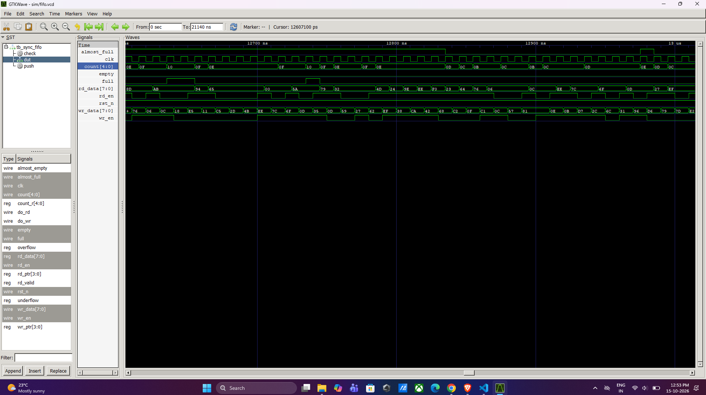
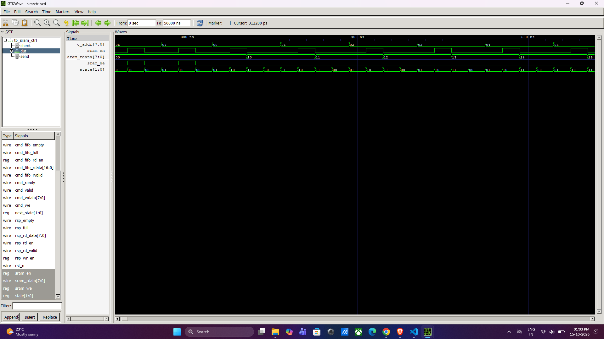

# Synchronous FIFO and FIFO-Buffered SRAM Controller (Verilog)

A synthesizable-style RTL design in Verilog consisting of a parameterized **synchronous FIFO** and an **SRAM controller** that uses two FIFOs to decouple a host from a synchronous SRAM. The design is verified with self-checking testbenches (golden-model scoreboard plus constrained-random stress) using **Icarus Verilog** and **GTKWave**.

## Features

- Parameterized synchronous FIFO (data width, depth, almost-full and almost-empty margins)
- Status flags: `full`, `empty`, `almost_full`, `almost_empty`, occupancy `count`
- Error flags: `overflow` (write when full) and `underflow` (read when empty)
- Registered read output with a `rd_valid` strobe (1-cycle read latency)
- SRAM controller with command FIFO, response FIFO, and a 4-state FSM
- Backpressure handling: the controller stalls instead of losing read data when the response FIFO is full
- Self-checking testbenches that report PASS/FAIL automatically

## Architecture

```
            +-------------+      +-------+      +--------+
 Host ----> |  CMD FIFO   | ---> |  FSM  | ---> |  SRAM  |
 commands   | {we,addr,   |      |       |      | (sync, |
            |  wdata}     |      |       | <--- | 1-cycle|
            +-------------+      +-------+  rd  | read)  |
                                     |      data +--------+
                                     v
            +-------------+
 Host <---- |  RSP FIFO   |
 responses  | (read data) |
            +-------------+
```

The host pushes read/write commands into the command FIFO. The FSM pops one command at a time and drives the SRAM. Read results are pushed into the response FIFO, which the host pops at its own pace.

## Project structure

```
sync_fifo_sram/
├── rtl/
│   ├── sync_fifo.v      # parameterized synchronous FIFO
│   ├── sram_model.v     # single-port synchronous SRAM (behavioural model)
│   └── sram_ctrl.v      # FIFO-buffered SRAM controller (top level)
├── tb/
│   ├── tb_sync_fifo.v   # self-checking FIFO testbench
│   └── tb_sram_ctrl.v   # self-checking controller testbench
├── docs/                # FSM diagram and waveform screenshots
├── sim/                 # generated .vvp and .vcd files (git-ignored)
├── .gitignore
└── README.md
```

## Module descriptions

### `sync_fifo`

| Parameter | Default | Description |
|---|---|---|
| `DATA_WIDTH` | 8 | Width of each word |
| `ADDR_WIDTH` | 4 | Depth = 2^ADDR_WIDTH (16 words) |
| `ALMOST_FULL_MARGIN` | 2 | `almost_full` when `count >= DEPTH - 2` |
| `ALMOST_EMPTY_MARGIN` | 2 | `almost_empty` when `count <= 2` |

| Port | Dir | Description |
|---|---|---|
| `clk`, `rst_n` | in | Clock and active-low asynchronous reset |
| `wr_en`, `wr_data` | in | Write request and data |
| `rd_en` | in | Read request |
| `rd_data`, `rd_valid` | out | Read data, valid one clock after an accepted `rd_en` |
| `full`, `empty` | out | Status flags |
| `almost_full`, `almost_empty` | out | Threshold flags |
| `count` | out | Current occupancy |
| `overflow`, `underflow` | out | One-cycle pulse when a write hits a full FIFO or a read hits an empty FIFO |

Behaviour notes:

- A write while full, or a read while empty, is ignored and flagged (the stored data is never corrupted).
- Simultaneous read and write keeps `count` unchanged. When the FIFO is full, a write is rejected even if a read happens in the same cycle (conservative behaviour).

### `sram_model`

Single-port synchronous SRAM (default 256 x 8). A write updates memory on the clock edge. A read updates `rdata` on the clock edge (1-cycle latency) and `rdata` holds its value until the next read. The `initial` block that zeroes memory is for simulation only.

### `sram_ctrl`

| Port group | Signals | Description |
|---|---|---|
| Command interface | `cmd_valid`, `cmd_ready`, `cmd_we`, `cmd_addr`, `cmd_wdata` | Valid/ready handshake. A command is accepted when `cmd_valid && cmd_ready`. `cmd_ready` is low when the command FIFO is full |
| Response interface | `rsp_rd_en`, `rsp_rd_data`, `rsp_rd_valid`, `rsp_empty`, `rsp_full` | Host pops read results from the response FIFO |
| Status | `busy` | High while the FSM is active or commands are still queued |

Command word: `{ we, addr, wdata }` (17 bits with the default widths). Both FIFOs are 8 entries deep (`FIFO_ADDR_WIDTH = 3`).

## FSM


| State | Code | Action | Next state |
|---|---|---|---|
| IDLE | `00` | Wait. If the command FIFO is not empty, pop a command | POP, or stay in IDLE |
| POP | `01` | Command FIFO output becomes valid | ACCESS |
| ACCESS | `10` | Drive `sram_en` (and `sram_we` for a write) for one cycle | IDLE (write) or RESP (read) |
| RESP | `11` | SRAM read data is valid; push it to the response FIFO | IDLE, or stay in RESP while the response FIFO is full |

Timing: a write takes 3 cycles (IDLE, POP, ACCESS) and a read takes 4 cycles (IDLE, POP, ACCESS, RESP), excluding stalls.

## Verification

Both testbenches are **self-checking**. A software reference model predicts the expected output, and every real output is compared against it. Each test prints PASS or FAIL and a final summary line.

### `tb_sync_fifo`

| Test | What it checks |
|---|---|
| T1 | Flags and count after reset |
| T2 | Fill to full, `almost_full` at DEPTH-2, `full` at DEPTH |
| T3 | Write when full is ignored |
| T4 | Drain in order (scoreboard), `almost_empty`, `empty` |
| T5 | Read when empty is ignored |
| T6 | Simultaneous read and write keeps `count` constant |
| T7 | 2000 cycles of random read/write stress, every accepted write read back exactly once and in order |

### `tb_sram_ctrl`

| Test | What it checks |
|---|---|
| T1 | Idle state after reset |
| T2 | Write 8 locations, read them back |
| T3 | Overwrite the same address, latest value returned |
| T4 | Backpressure: response FIFO fills and the controller stalls with no data lost or duplicated |
| T5 | 1500 random read/write commands against the golden memory model |

### Results

| Testbench | Checks | Result |
|---|---|---|
| `tb_sync_fifo` | 11 directed checks, 965 words verified | 0 errors, ALL TESTS PASSED |
| `tb_sram_ctrl` | 1599 commands, 811 reads checked | 0 errors, ALL TESTS PASSED |

### Waveforms

**Synchronous FIFO** (`sim/fifo.vcd`)



`count` changes by one per accepted write or read, `full` and `almost_full` assert at the expected thresholds, and `rd_data` appears one clock after `rd_en`.

**SRAM controller** (`sim/ctrl.vcd`)



`state` follows `00 -> 01 -> 10 -> 00` for a write and `00 -> 01 -> 10 -> 11 -> 00` for a read. `sram_en` and `sram_we` are high only during ACCESS, and `sram_rdata` returns the value stored at `c_addr`.

## How to run

Requirements: [Icarus Verilog](https://bleyer.org/icarus/) and GTKWave. The code is plain Verilog, so it compiles with `-g2005`. Run all commands from the project root.

```bash
mkdir sim
```

FIFO testbench:

```bash
iverilog -g2005 -Wall -o sim/fifo.vvp rtl/sync_fifo.v tb/tb_sync_fifo.v
vvp sim/fifo.vvp
gtkwave sim/fifo.vcd
```

SRAM controller testbench:

```bash
iverilog -g2005 -Wall -o sim/ctrl.vvp rtl/sync_fifo.v rtl/sram_model.v rtl/sram_ctrl.v tb/tb_sram_ctrl.v
vvp sim/ctrl.vvp
gtkwave sim/ctrl.vcd
```

A passing run ends with `*** SYNC FIFO: ALL TESTS PASSED ***` and `*** SRAM CONTROLLER: ALL TESTS PASSED ***` respectively. Any `[FAIL]` line points to the failing check and simulation time.

## Design notes and limitations

- Single clock domain. The FIFOs are not suitable for clock-domain crossing.
- The SRAM is a behavioural model, not a vendor memory macro. On an FPGA it would infer block RAM, and the `initial` block is simulation-only.
- The controller handles one command at a time (no pipelining), so throughput is one write per 3 cycles and one read per 4 cycles.

## Possible extensions

- Dual-clock FIFO with Gray-code pointers
- Pipelined controller overlapping POP and ACCESS
- Byte-enable writes and burst commands
- Synthesis and timing report (Yosys or Vivado)
- SystemVerilog assertions or formal checks for the FIFO flags

## Tools

Icarus Verilog, GTKWave, Visual Studio Code